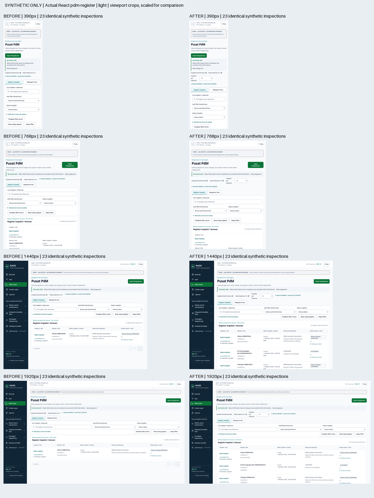
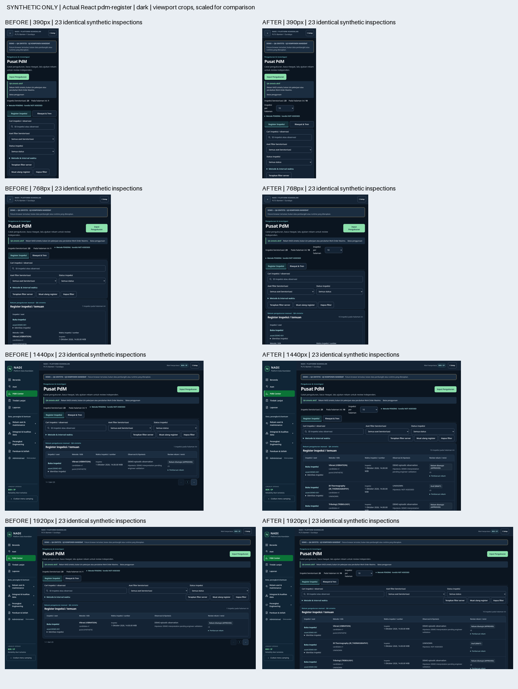
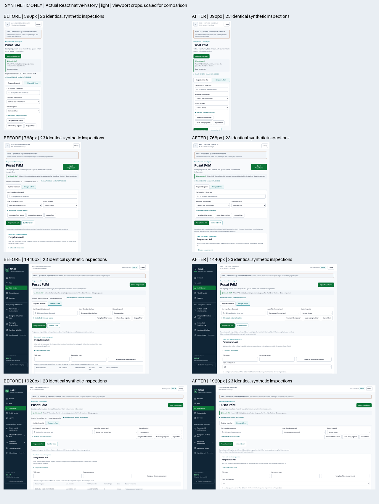
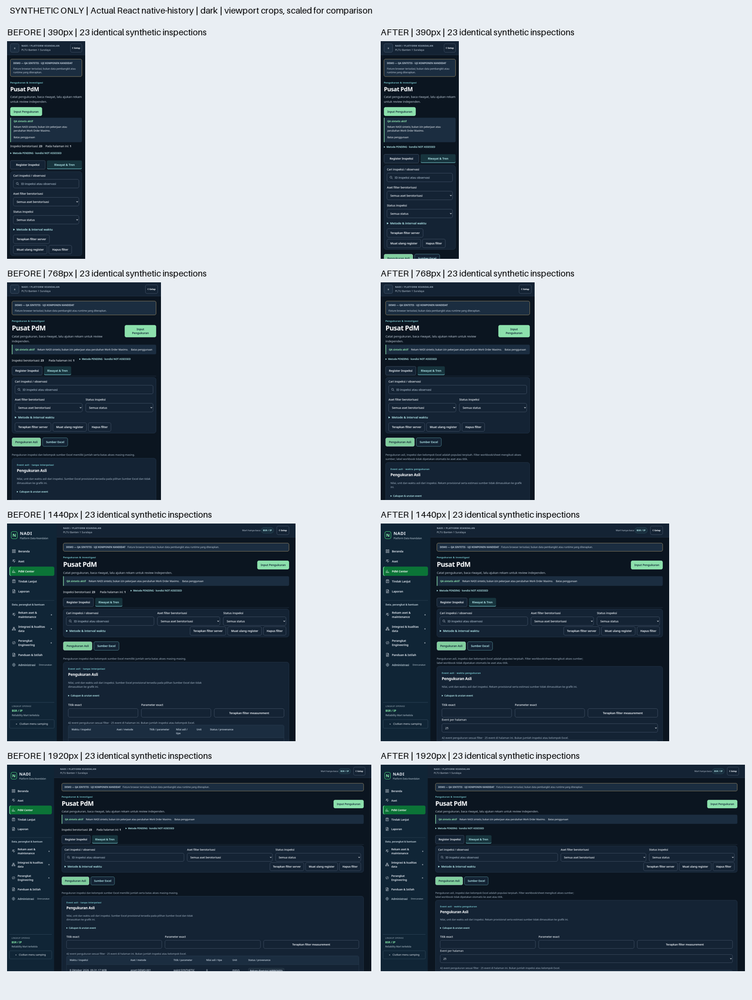

# Sprint2 actual-component comparison — SYNTHETIC ONLY

These are actual imported React components against identical deterministic23-record
synthetic fixtures. All .invalid requests are intercepted. **No image is live
localhost, plant evidence, retained data, method sign-off or PO acceptance.**
Before source is accepted PR114 `aa065af9cef01d8ee3358bcca8fc628ba311ca3a`;
after source is the immutable head of this Sprint2 PR. Test entry is separate from
all28 unchanged application pages; the synthetic trend has no product route.

## Matched viewport contact sheets

Each row is390/768/1440/1920; BEFORE left, AFTER right. Crops show the first1086px
of the real screenshots, uniformly scaled to fit; they are presentation comparisons,
not full history completeness evidence. Full originals remain in the owner-private
local evidence directory; hashes of every full capture are in manifest.json.

## Full representative captures

| Screen | Accepted baseline | Sprint2 candidate |
| --- | --- | --- |
| Register390/light | [before](before-pdm-register-light-390.png) | [after](after-pdm-register-light-390.png) |
| Register1440/light | [before](before-pdm-register-light-1440.png) | [after](after-pdm-register-light-1440.png) |
| Native history390/light | [before](before-native-history-light-390.png) | [after](after-native-history-light-390.png) |
| Native history1440/light | [before](before-native-history-light-1440.png) | [after](after-native-history-light-1440.png) |

[Clearly labelled synthetic future trend demonstrator](synthetic-trend-light-1440.png)
is a test fixture only, not a real comparable series or an activated app feature.

Candidate103 checks include64 axe-scanned combinations(8screens×4widths×2themes),
no page overflow/browser errors, exact page/count/deep-link/Back/Forward/413/error
semantics, existing dirty navigation and keyboard drawer/source-estimate disclosure.
First full Register row at1440×900 spans727.19–876.98px. Baseline59 checks capture
7screens×4widths×2themes(56captures), no baseline axe acceptance claim.
Reports: candidate-browser-results.json, baseline-browser-results.json,
disposable-ui-api-results.json(6 actual UI/trustedAPI/PG scenarios),
draft-session-results.json(14 session/draft/scope/413 scenarios).

Visual review observed a contained Register table/cards, all ten rows and honest
23total/threepages, separate native event count/filters/time basis, raw accessible
values/provenance and explicit pending comparability state. Long mobile history is
bounded25events and can be reduced to10/1; it is not truncated into a fake summary.
No source estimates or provisional groups enter the native scatter.
