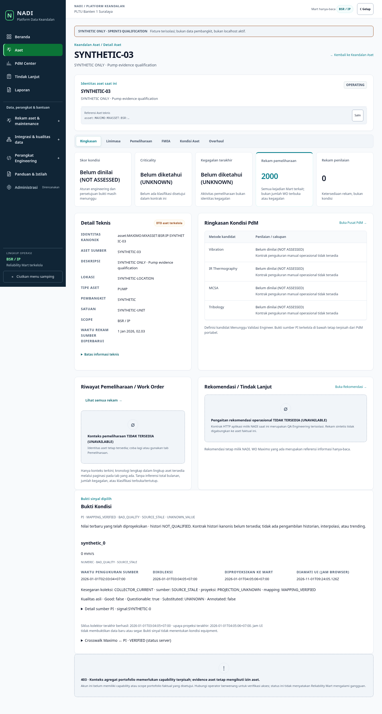
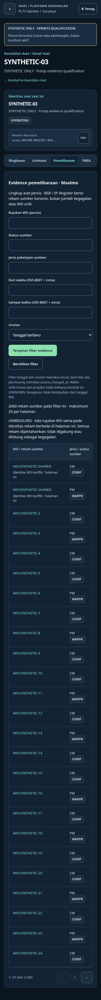

# Sprint3 synthetic screenshot gallery

**SYNTHETIC ONLY.** Actual candidate React components rendered on a completely
intercepted `.invalid` origin. These are not live localhost screenshots, real plant
measurements, source-owner approvals or PO acceptance. No listening frontend or
retained database was used. The visible UI observation clock is the browser clock.

Reproduce from `reliability-cockpit/web`: `node scripts/asset-evidence-browser.mjs`
with Playwright and optional `NADI_AXE_MODULE`. Hosted exact-head CI uploads the
same actual-component matrix as an artifact named with the immutable head SHA.
`results.json` records navigation checks and7 automated WCAG states; `SHA256SUMS`
identifies these supplied bytes. Screenshots are reviewed for layout/readability;
automated checks do not replace human visual/accessibility acceptance.

| Screen / state | Screenshot |
| --- | --- |
| 01-asset-register-desktop-light | [Open](01-asset-register-desktop-light.png) |
| 02-asset-condition-latest | [Open](02-asset-condition-latest.png) |
| 03-maintenance-register | [Open](03-maintenance-register.png) |
| 04-maintenance-source-detail | [Open](04-maintenance-source-detail.png) |
| 05-pi-source-crosswalk | [Open](05-pi-source-crosswalk.png) |
| 07-ambiguous-mapping | [Open](07-ambiguous-mapping.png) |
| 06-condition-403 | [Open](06-condition-403.png) |
| 08-maintenance-empty | [Open](08-maintenance-empty.png) |
| 09-maintenance-390-light | [Open](09-maintenance-390-light.png) |
| 09-maintenance-390-dark | [Open](09-maintenance-390-dark.png) |
| 09-maintenance-1440-light | [Open](09-maintenance-1440-light.png) |
| 09-maintenance-1440-dark | [Open](09-maintenance-1440-dark.png) |

The fixture includes a2000-row synthetic maintenance population while loading25
rows per page, deliberate shared-WO identities, null actual dates, zero, false,
null and digital code0, stale/bad/questionable quality, separately preserved source,
collection/projection/UI clocks, unresolved mapping and403. Source details are
progressive disclosures. All screenshots carry a synthetic qualification banner.

