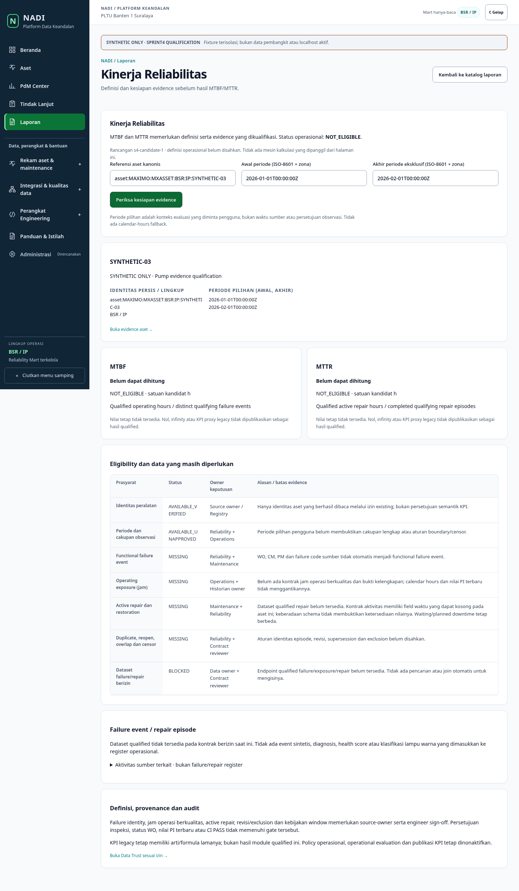
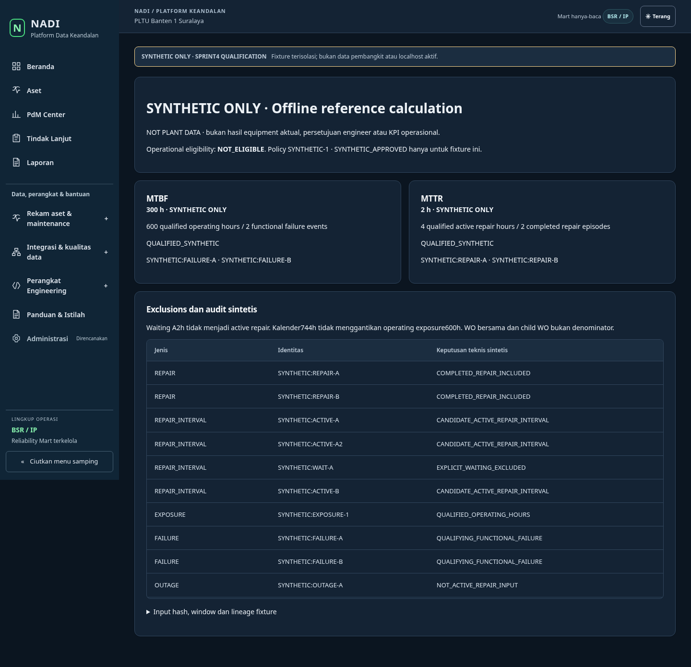

# Sprint4 synthetic UI screenshot gallery

**SYNTHETIC ONLY — NOT PLANT DATA.** Actual candidate React components on a
fully intercepted `.invalid` origin. No listening frontend, localhost session,
retained records or source system was used. The operational UI displays no
invented KPI; the numeric reference is a separate test-only demonstrator, not an
application page/import, approved engineering result or equipment measurement.

6 scenario groups,10 screenshots,8 automated WCAG2A/AA/2.1A/AA states. Tests cover
390/768/1440 light/dark with actual theme controls, selection/return/browser history,
exact scoped lazy activity detail, loading/empty/404/401/403/503 and stale scope
clearing. These automated results do not certify human visual/accessibility UAT.

Run `node scripts/reliability-performance-browser.mjs` from cockpit/web with
Playwright and optional NADI_AXE_MODULE. The hosted artifact name includes the
exact final HEAD. `results.json` and `SHA256SUMS` identify these supplied bytes.

| State | Screenshot |
| --- | --- |
| 01-performance-empty | [Open](01-performance-empty.png) |
| 02-performance-readiness | [Open](02-performance-readiness.png) |
| 03-authorized-activity-source | [Open](03-authorized-activity-source.png) |
| 04-performance-403 | [Open](04-performance-403.png) |
| 05-loading | [Open](05-loading.png) |
| 06-readiness-390-light | [Open](06-readiness-390-light.png) |
| 06-readiness-390-dark | [Open](06-readiness-390-dark.png) |
| 06-readiness-1440-light | [Open](06-readiness-1440-light.png) |
| 06-readiness-1440-dark | [Open](06-readiness-1440-dark.png) |
| 07-synthetic-reference | [Open](07-synthetic-reference.png) |

